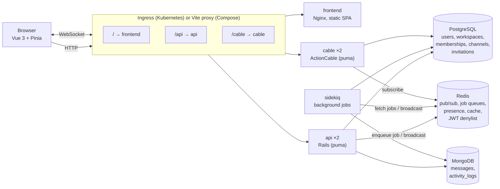

# Obrolin

A Slack-like team chat app built as a learning project. It shows how a Rails
API, a Vue 3 SPA, PostgreSQL, MongoDB, Redis, ActionCable, Sidekiq, Docker and
Kubernetes fit together in one realistic system.

Features: accounts (JWT), workspaces with roles and email invitations, public
and private channels, real-time messaging, edit/soft delete, emoji reactions,
threads, @mentions with notifications, presence, typing indicators, unread
counts, infinite scroll history and per-channel full-text search.

- [Architecture](#architecture)
- [Why three data stores](#why-three-data-stores)
- [Run with Docker Compose](#run-with-docker-compose)
- [Run on Kubernetes (kind or minikube)](#run-on-kubernetes-kind-or-minikube)
- [Verify WebSockets across cable pods](#verify-websockets-across-cable-pods)
- [Tests](#tests)
- [API and WebSocket reference](#api-and-websocket-reference)
- [Troubleshooting](#troubleshooting)

## Architecture



The **same backend image** runs three roles, chosen by the container command:

| Role    | Command                                      | Why separate                                                   |
|---------|----------------------------------------------|----------------------------------------------------------------|
| api     | `bundle exec puma -C config/puma.rb`         | Short REST requests; scaled by the HPA on CPU                  |
| cable   | `bundle exec puma -p 3000 cable/config.ru`   | Long-lived WebSockets; scaled by connection count, not CPU     |
| sidekiq | `bundle exec sidekiq -C config/sidekiq.yml`  | Slow work (emails, notifications) off the request path         |

**How a message travels.** `POST /api/v1/channels/:id/messages` hits an api
pod, which saves the document in MongoDB and calls
`ActionCable.server.broadcast("conversation:<id>", ...)`. That publishes to
Redis. Every cable pod subscribes to Redis, so each one forwards the event to
the browsers connected to *it*. That is why two cable pods behind a load
balancer still deliver every message to every client.

**Authentication.** The REST API takes `Authorization: Bearer <jwt>`. Browsers
cannot set headers on a WebSocket handshake, so the same JWT is passed as
`/cable?token=<jwt>` and verified in `ApplicationCable::Connection`. Logout
stores the token's `jti` in a Redis denylist until the token would expire.

## Why three data stores

**PostgreSQL** holds data that is relational and must stay consistent:
`users`, `workspaces`, `workspace_memberships` (owner/admin/member),
`channels`, `channel_memberships` (with `last_read_at`) and `invitations`.
These rows reference each other, need unique constraints ("one membership per
user per workspace") and change together in transactions (creating a
workspace creates its owner membership and default channels atomically).

**MongoDB** holds data that is high-volume and document-shaped:

- `messages`: every chat line, with `mentions[]`, embedded `reactions[]`
  (emoji + user ids), `parent_message_id` for threads, `edited_at`,
  `deleted_at`. A message and its reactions are always read together, so
  embedding avoids joins. Volume grows much faster than any relational table.
- `activity_logs`: an audit trail whose `metadata` differs per action, which
  a schemaless store handles naturally.

Indexes (`backend/app/models/message.rb`):

- `{ channel_id: 1, created_at: -1 }`: channel history, newest first
- `{ parent_message_id: 1, created_at: 1 }`: thread replies
- `{ body: "text" }`: full-text search

Messages reference PostgreSQL ids (`channel_id`, `user_id`) without foreign
keys. Integrity is enforced in application code, and authors are loaded in one
batched query and stitched in Ruby (`MessageSerializer.render_many`), an
"application-level join".

**Redis** holds fast, ephemeral, shared state:

| Use                 | Where                                     | Notes                                                     |
|---------------------|-------------------------------------------|-----------------------------------------------------------|
| ActionCable pub/sub | DB 1 (`config/cable.yml`)                 | Fans broadcasts out to all cable pods                     |
| Sidekiq queues      | DB 2 (`config/initializers/sidekiq.rb`)   | `default` and `mailers` queues                            |
| Presence            | DB 0, `obrolin:presence:<user_id>`        | Sorted set of connection ids with heartbeat scores + TTL  |
| JWT denylist        | DB 0, `obrolin:jwt:denylist:<jti>`        | Expires with the token                                    |
| Rate limiting/cache | DB 0 via `Rails.cache`                    | `rate_limit` on message creation                          |

Typing indicators are broadcast only and never stored.

**Cursor pagination.** History uses the oldest loaded message id as a cursor
(`?before=<id>`) instead of `OFFSET`. New messages arriving at the top never
shift the pages a user is scrolling through, and the query stays an index
range scan however deep you scroll.

**Unread counts.** `last_read_at` lives in PostgreSQL, messages in MongoDB.
`UnreadCounter` runs one aggregation that matches each channel's
`created_at > last_read_at` and groups by channel, instead of one count per
channel.

## Run with Docker Compose

Requirements: Docker Desktop (or Docker Engine + Compose v2).

```sh
make dev-up          # creates .env with a random JWT_SECRET on first run
```

| URL                                   | What                                     |
|---------------------------------------|------------------------------------------|
| http://localhost:5173                 | The app (Vite dev server, hot reload)    |
| http://localhost:3001/up              | API health check                         |
| http://localhost:3002/letter_opener   | Emails "sent" by Sidekiq (invitations, mentions) |

Sign in as **alice**, **budi**, **citra** or **dimas**, all with password
`password123`. The first `make dev-up` runs the `migrate` service
(`db:prepare` + Mongo indexes), which also loads the seed data into a fresh
database. Try two browsers (or a private window) with different users to see
real-time messages, typing and presence.

Other commands:

```sh
make dev-logs SERVICE=sidekiq   # follow one service
make dev-seed                   # reload demo data (idempotent)
make dev-console                # Rails console
make dev-down                   # stop (keeps data)
make dev-reset                  # stop and delete all data volumes
make help                       # everything else
```

How the Compose stack is wired:

- `api`, `cable`, `sidekiq`, `letter_opener` and `migrate` all use the
  `obrolin-backend:dev` image, with `./backend` bind-mounted for live reload.
- The browser only talks to `localhost:5173`. Vite proxies `/api` to `api`
  and `/cable` (WebSocket) to `cable`, the same routing the Kubernetes
  ingress does. The frontend never hardcodes a backend URL.
- `depends_on` with `service_healthy` / `service_completed_successfully`
  makes services wait for healthy databases and finished migrations.
- PostgreSQL is published on host port **5433** (set `POSTGRES_HOST_PORT` to
  change it) to avoid clashing with a locally installed Postgres.

### Running Rails on the host instead

```sh
make infra-up        # only postgres, mongodb, redis
make api             # Rails on http://localhost:3001 (reads ../.env)
cd frontend && npm install && npm run dev
```

## Run on Kubernetes (kind or minikube)

Requirements: Docker, `kubectl` (1.27+, includes Kustomize) and either
[kind](https://kind.sigs.k8s.io/) (`brew install kind`) or minikube. Give
Docker at least 4 GB of memory, and stop the Compose stack first
(`make dev-down`) so both do not compete for it.

### 1. Create a cluster with an ingress controller and metrics-server

```sh
make k8s-cluster
```

With kind this creates the `obrolin` cluster from `k8s/kind-config.yaml`
(host ports 80/443 mapped into the node), installs **ingress-nginx** and
**metrics-server**. metrics-server is what the HorizontalPodAutoscaler reads
CPU usage from. Without it, `kubectl get hpa` shows `<unknown>` and nothing
scales. On kind it needs `--kubelet-insecure-tls` because kubelets use
self-signed certificates; the Makefile patches that in.

With minikube: `make k8s-cluster CLUSTER=minikube` (enables the `ingress` and
`metrics-server` addons). Pass `CLUSTER=minikube` to `k8s-load` as well.

### 2. Build the production images and load them into the cluster

```sh
make k8s-build      # obrolin-backend:local, obrolin-frontend:local (production targets)
make k8s-load       # kind load docker-image ... (or minikube image load)
```

Images are never pushed to a registry. They are copied into the cluster
node, and the manifests use `imagePullPolicy: IfNotPresent` (the default for
non-`latest` tags).

### 3. Deploy

```sh
make k8s-deploy     # apply, wait for databases, run the migrate Job, wait for rollouts
make k8s-seed       # optional: demo workspace, users and messages
```

`k8s-deploy` applies `k8s/overlays/local`, waits for the StatefulSets, runs
the `obrolin-migrate` Job (`db:create db:migrate db:mongoid:create_indexes`)
and then waits for the Deployments. The api pods also have an initContainer
that blocks until no migrations are pending, so the API never serves traffic
against an old schema, even if you apply manifests in a different order.

Jobs are immutable, so `make k8s-migrate` deletes the previous Job before
creating a new one. That is also how you run migrations after a code change:

```sh
make k8s-build k8s-load k8s-migrate k8s-restart
```

### 4. Point obrolin.local at the cluster

```sh
echo "127.0.0.1 obrolin.local" | sudo tee -a /etc/hosts
```

On minikube with the Docker driver on macOS, run `minikube tunnel` in another
terminal and keep `127.0.0.1`. With other drivers, use the IP from
`minikube ip` instead.

Open **http://obrolin.local** and sign in as `alice` / `password123`.

### 5. Inspect

```sh
make k8s-status                 # pods, services, ingress, HPA, jobs, PVCs
make k8s-logs SERVICE=cable     # all cable pods, prefixed with the pod name
kubectl -n obrolin top pods     # needs metrics-server
make k8s-destroy                # delete the namespace (and its data)
make k8s-cluster-delete         # delete the kind cluster
```

### What is in `k8s/`

```
k8s/
├── kind-config.yaml
├── base/
│   ├── kustomization.yaml      # namespace, labels, ConfigMap generator
│   ├── namespace.yaml
│   ├── secret.yaml             # EXAMPLE values only (see below)
│   ├── postgres.yaml           # Service + StatefulSet + PVC
│   ├── mongodb.yaml            # Service + StatefulSet + PVC
│   ├── redis.yaml              # Service + StatefulSet + PVC (AOF on)
│   ├── api.yaml                # Service + Deployment (2 replicas, wait-for-migrations init)
│   ├── cable.yaml              # Service + Deployment (2 replicas)
│   ├── sidekiq.yaml            # Deployment (no Service)
│   ├── frontend.yaml           # Service + Deployment (Nginx)
│   ├── ingress.yaml            # /cable (long timeouts) and /api + / on obrolin.local
│   ├── hpa.yaml                # api: 2-5 replicas at 70% CPU
│   └── jobs/{migrate,seed}/    # applied separately, before/after rollout
└── overlays/local/             # :local image tags, obrolin.local origins
    └── jobs/{migrate,seed}/
```

Choices worth noticing:

- **Every container** has resource requests and limits. The HPA's 70% target
  is a percentage of the CPU *request*.
- **Probes.** api uses Rails' `/up`. cable serves a plain `/up` next to the
  WebSocket endpoint (`backend/cable/config.ru`). Sidekiq has no HTTP port, so
  its `:beat` event touches `/tmp/sidekiq_alive` and an exec probe checks the
  file's age. Nginx serves `/healthz`. Slow-booting Rails containers get a
  `startupProbe` so the liveness probe cannot kill them during boot. MongoDB's
  liveness probe is a cheap TCP check (see Troubleshooting for why).
- **Two Ingress objects for one host.** ingress-nginx annotations apply to a
  whole Ingress, and only `/cable` should get
  `proxy-read-timeout`/`proxy-send-timeout: 3600`.
- **CORS and ActionCable origins** both come from `ALLOWED_ORIGINS`
  (`http://obrolin.local` in the local overlay). Behind the ingress the SPA
  and API share an origin, so CORS mostly matters for local development.
- **The ConfigMap keeps a stable name** (no hash suffix) because the Jobs live
  in separate kustomizations. After editing it, run `make k8s-restart`.

### Secrets

`k8s/base/secret.yaml` contains obviously fake example values so the project
runs out of the box. Never commit real secrets. Create them instead:

```sh
kubectl -n obrolin create secret generic obrolin-secrets \
  --from-literal=POSTGRES_USER=obrolin \
  --from-literal=POSTGRES_PASSWORD="$(openssl rand -hex 16)" \
  --from-literal=SECRET_KEY_BASE="$(openssl rand -hex 64)" \
  --from-literal=JWT_SECRET="$(openssl rand -hex 64)" \
  --dry-run=client -o yaml | kubectl apply -f -
```

Then remove `secret.yaml` from the kustomization so `kubectl apply -k` does
not overwrite it. In a real cluster, use External Secrets, Sealed Secrets,
SOPS or Vault. Note that Postgres only reads `POSTGRES_PASSWORD` when its data
directory is first initialised. Changing it later requires `ALTER USER` (or
`make k8s-destroy` locally).

### What would change for production

- **Databases**: managed services (RDS/Cloud SQL, Atlas, ElastiCache) or
  operators (CloudNativePG, the MongoDB operator) with replicas, backups and
  failover, instead of single-replica StatefulSets. MongoDB as a 3-member
  replica set with auth; Redis with Sentinel or a managed failover setup.
- **Images** pushed to a registry with immutable tags (git SHA), not loaded
  by hand.
- **TLS** at the ingress (cert-manager) and `FORCE_SSL=true`.
- **Secrets** from a secret manager; SMTP configured (`SMTP_ADDRESS` etc.).
  Without it production mail is only logged, which is why admins can also
  copy invite links from the UI.
- **Scaling**: PodDisruptionBudgets, anti-affinity across nodes, autoscaling
  cable on connection count and Sidekiq on queue latency (e.g. KEDA).
- **Ingress controller**: ingress-nginx was retired upstream in March 2026
  (its last release, `controller-v1.15.1`, is what this repo pins). It is fine
  for learning; new production setups should prefer a maintained controller
  or the Gateway API.

## Verify WebSockets across cable pods

The cable Deployment runs **2 replicas**. A message published through any api
pod must reach clients on *both* cable pods, which only works because
ActionCable uses Redis pub/sub.

**Automated check:**

```sh
make k8s-verify
```

`scripts/verify-cable.mjs` logs in as alice, opens 8 WebSocket connections to
`/cable`, posts one message through the REST API and reports which pod each
connection landed on and whether it received the broadcast:

```
  connection 1: server=cable-5c5bf78879-rpjqf  received=yes
  connection 5: server=cable-5c5bf78879-2wvth  received=yes
  ...
Cable servers seen: 2 (cable-5c5bf78879-rpjqf, cable-5c5bf78879-2wvth)
PASS: every connection received the broadcast.
```

Each subscription is answered with the pod's hostname
(`ConversationChannel#subscribed`), and the test message is deleted afterwards.
The same script works against Compose: `node scripts/verify-cable.mjs http://localhost:5173 4`.

**By hand:**

1. Open http://obrolin.local in two browsers as different users.
2. The sidebar footer shows `cable: <pod name>` for each tab. Reload one tab
   until the two show different pods.
3. Send a message, react, or start typing in one: the other sees it
   immediately.
4. Optional: `kubectl -n obrolin scale deployment/cable --replicas=3`, or
   delete a cable pod and watch the client reconnect (ActionCable retries
   automatically).

To see the bus itself: `kubectl -n obrolin exec -it redis-0 -- redis-cli -n 1 monitor`
while sending messages.

## Tests

```sh
make infra-up       # tests use the postgres/mongodb/redis containers
make test           # RSpec (backend) + Vitest (frontend)
make lint           # RuboCop
```

- Backend (`backend/spec`): models, cursor pagination, presence, unread
  aggregation, every REST endpoint, ActionCable connection auth and channels,
  and both Sidekiq jobs. Specs use Redis DB 15 and a separate Mongo database.
- Frontend (`frontend/tests`): message rendering (HTML escaping, mentions,
  links), grouping, the messages store (pagination, idempotent upserts,
  threads, typing) and the API client.

## API and WebSocket reference

All REST endpoints are under `/api/v1` and need `Authorization: Bearer <token>`
unless noted.

| Method | Path | Notes |
|---|---|---|
| POST | `/auth/register` | public. `{ user: { email, username, display_name, password } }` |
| POST | `/auth/login` | public. `{ login: <email or username>, password }` |
| DELETE | `/auth/logout` | revokes the token |
| GET/PATCH | `/me` | changing `password` requires `current_password` |
| GET/POST | `/workspaces` | create makes you owner + #general, #random |
| GET/PATCH | `/workspaces/:id` | PATCH: owner/admin |
| GET | `/workspaces/:id/members` | with `role` and `online` |
| PATCH/DELETE | `/workspaces/:id/members/:user_id` | role change (owner), remove/leave |
| GET/POST/DELETE | `/workspaces/:id/invitations` | owner/admin. POST `{ email }` enqueues the email job |
| GET | `/invitations/:token` | public preview |
| POST | `/invitations/:token/accept` | email must match the invitation |
| GET/POST | `/workspaces/:id/channels` | list with `is_member`, `unread_count`. POST `{ channel: { name, description, is_private }, member_ids }` |
| GET/PATCH | `/channels/:id` | |
| POST/DELETE | `/channels/:id/join`, `/channels/:id/leave` | join: public channels only |
| POST | `/channels/:id/read` | sets `last_read_at` = now |
| GET/POST | `/channels/:id/members` | POST `{ user_id }` (add to private channel) |
| GET | `/channels/:id/messages?before=<id>&limit=30` | `{ messages (newest first), next_cursor }` |
| POST | `/channels/:id/messages` | `{ message: { body, parent_message_id? } }`, rate limited |
| GET | `/channels/:id/messages/search?q=` | MongoDB `$text` search |
| PATCH/DELETE | `/messages/:id` | edit (author), soft delete (author or admin) |
| GET | `/messages/:id/replies` | thread |
| POST | `/messages/:id/reactions` | `{ emoji }` toggles your reaction |

WebSocket: `ws(s)://<host>/cable?token=<jwt>`

| Channel | Params | Server → client events | Client actions |
|---|---|---|---|
| `ConversationChannel` | `channel_id` | `subscribed` (with `server`), `message.created`, `message.updated`, `message.deleted`, `thread.updated`, `typing`, `member.joined`, `member.left`, `channel.updated` | `typing` |
| `PresenceChannel` | `workspace_id` | `presence` `{ user_id, online }` | `heartbeat` (every 30s) |
| `NotificationsChannel` | none | `mention` | none |

The client subscribes to `ConversationChannel` for **every** joined channel
(all multiplexed over one socket) so it can bump unread badges for channels
that are not open.

## Troubleshooting

**`bind: address already in use` on `make dev-up`.** Another process uses
5173, 3001, 3002, 5433, 27017 or 6379. Stop it, or change the left side of the
port mapping in `docker-compose.yml` (`POSTGRES_HOST_PORT` is already a
variable). For kind, host ports 80/443 must be free.

**Login works but nothing is real-time / sidebar shows no `cable:` label.**
The WebSocket is failing. Check the browser devtools Network → WS tab and
`make dev-logs SERVICE=cable` (or `make k8s-logs SERVICE=cable`):
- `Request origin not allowed`: add your origin to `ALLOWED_ORIGINS`.
- `An unauthorized connection attempt was rejected`: the token is missing or
  expired; sign out and in again.
- Disconnects after exactly 60s on Kubernetes: the `/cable` Ingress is
  missing its `proxy-read-timeout` / `proxy-send-timeout` annotations.

**`Error loading the 'redis' Action Cable pubsub adapter`.** ActionCable 8.0
requires the `redis` gem `< 6`; the Gemfile pins `~> 5.4`. Do not bump it
until Rails supports redis 6.

**Sidekiq logs `wrong number of arguments (given 1, expected 0)` from
`connection_pool`.** connection_pool 3.x changed an API that Sidekiq 7.3's
scheduler uses; the scheduler thread dies and scheduled/retried jobs never
run. The Gemfile pins `connection_pool ~> 2.5`.

**`unknown keyword: quirks_mode` when rendering JSON.** json 3.x removed an
option ActiveSupport 8.0 still passes; the Gemfile pins `json ~> 2.10`.

**Pods stuck in `ErrImageNeverPull` / `ImagePullBackOff`.** The images were
not loaded into this cluster: `make k8s-build k8s-load`, then
`make k8s-restart`. With minikube, pass `CLUSTER=minikube`.

**api pods stuck in `Init:0/1`.** The `wait-for-migrations` initContainer is
waiting for the migrate Job: `make k8s-migrate`, then
`kubectl -n obrolin logs job/obrolin-migrate`. A failed first Job pod while
MongoDB is still starting is normal; the Job retries (`backoffLimit: 6`).

**MongoDB pod keeps restarting.** Probes that exec `mongosh` (a Node.js
program) can time out under a CPU limit, and a liveness probe that times out
kills a healthy database. This repo uses a TCP liveness probe and a
long-timeout `mongosh` readiness probe for that reason.

**Sidekiq restarts every minute on Kubernetes.** The liveness probe checks
`/tmp/sidekiq_alive`, which must be touched on Sidekiq's `:beat` event
(every heartbeat). `:heartbeat` fires only once at startup.

**`obrolin.local` does not resolve or shows the nginx 404 page.** Check the
`/etc/hosts` entry, that `kubectl -n ingress-nginx get pods` shows a running
controller, and that `kubectl -n obrolin get ingress` lists host
`obrolin.local`. On minikube with the Docker driver, `minikube tunnel` must be
running.

**HPA shows `<unknown>/70%`.** metrics-server is missing or not ready:
`make k8s-metrics`, then wait a minute and check `kubectl top pods -n obrolin`.

**Invitation emails.** In Compose, open http://localhost:3002/letter_opener.
On Kubernetes there is no SMTP server, so mail is only logged; admins can copy
the invite link from the "Invite people" dialog instead.

**Pods are `Pending` or `OOMKilled`.** The cluster is out of memory. Give
Docker more memory, stop the Compose stack, or scale down:
`kubectl -n obrolin scale deployment/api deployment/cable --replicas=1`.

**Reset everything.** Compose: `make dev-reset`. Kubernetes:
`make k8s-destroy` (namespace and PVCs) or `make k8s-cluster-delete`.
